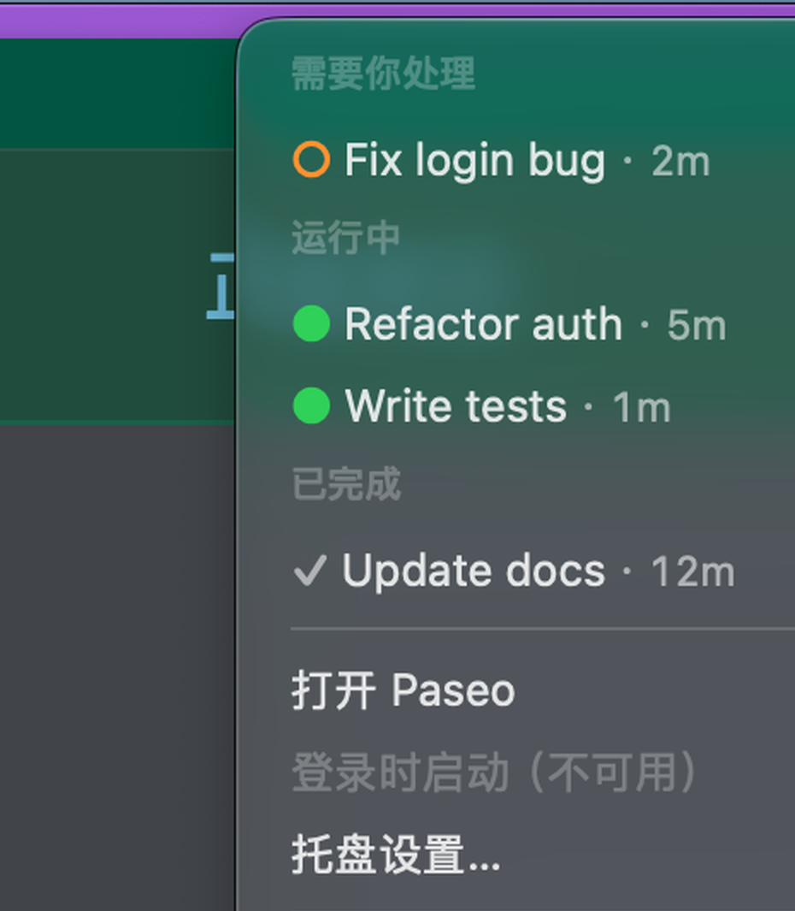
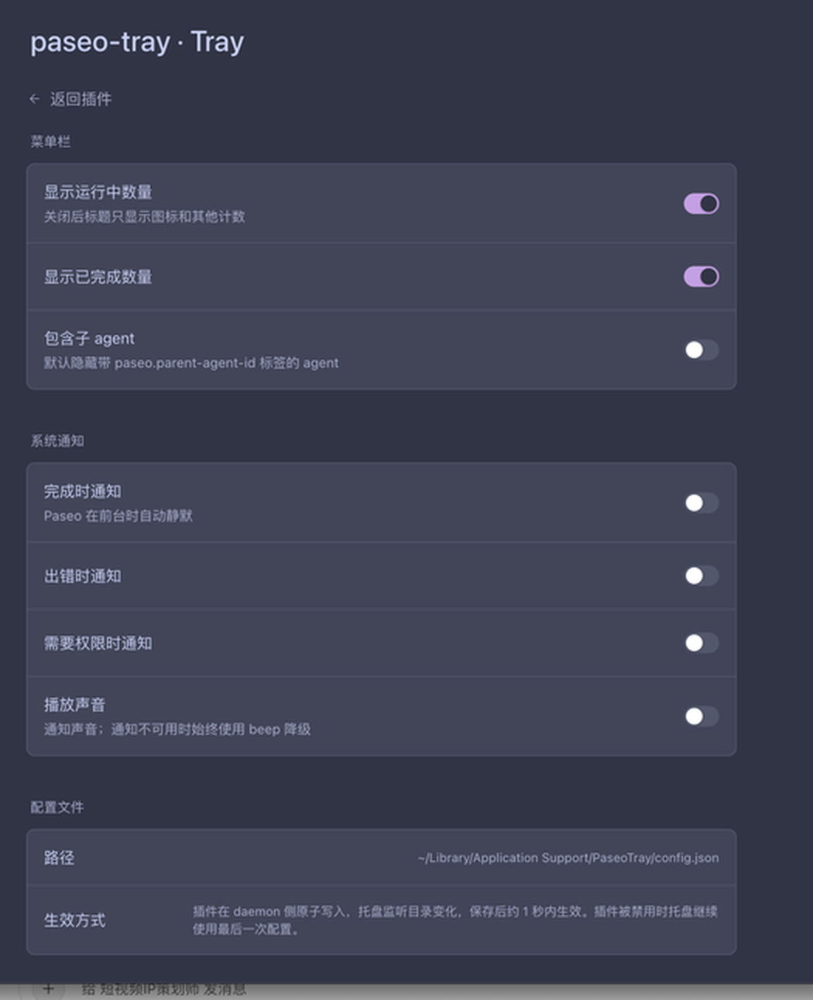

# 验收记录

执行时间：2026-11-05（本机 macOS 27.0.1 / arm64）
运行中的 Paseo：**0.14.0**，daemon `127.0.0.1:6767`，`serverId=srv_example`
参考源码：`Paseo 0.15.0 源码（只读参考）`（0.15.0）

> 没有重启真实 daemon。仓库规则明确禁止在 6767 上重启 daemon；验收项 6 用 `test/mock-daemon.mjs` 完成同等的“daemon 消失 → 托盘重连 → 重新订阅”验证。

## 1. 构建与基础诊断

```bash
cd tray
./build.sh
```

结果：`Built: .../tray/build/PaseoTray.app`，`plutil -lint` OK，`codesign --verify --deep --strict` 通过。

```bash
./tray/build/PaseoTray.app/Contents/MacOS/PaseoTray --version
# PaseoTray 0.1.0

./tray/build/PaseoTray.app/Contents/MacOS/PaseoTray --self-check
# self-check: OK (14 assertions)
```

`--self-check` 覆盖：状态桶优先级、background/internal/subagent/archived 过滤、needs_input/failed/running/attention 排序、`includeSubagents`。

## 2. 真实 daemon 连接

```bash
PASEO_HOME=~/.paseo ./tray/build/PaseoTray.app/Contents/MacOS/PaseoTray --selftest
```

关键输出：

```json
{"event":"status","phase":"connected","serverVersion":"0.14.0"}
{"event":"snapshot","counts":{"running":2,"finished":0,"needsInput":0,"failed":0,"total":2},"serverId":"srv_example"}
```

菜单栏标题（System Events 读取）：

```bash
osascript -e 'tell application "System Events" to tell process "PaseoTray" to get title of menu bar item 1 of menu bar 1'
# ▶ 2
```

真实 daemon 菜单（System Events 读取）：

```text
运行中, ● running agent A · 32m, ● finished agent B · 12m,
missing value, 打开 Paseo, 登录时启动, 托盘设置…, missing value, 退出,
Paseo 0.14.0 · srv_example
```

期间 `finished agent B` 完成过一次，菜单出现过：

```text
已完成, ✓ finished agent B · 1s
```

之后用户在 Paseo 打开该 agent，`✓` 被 daemon 清掉；`--selftest` 回到 `finished:0`。这验证了“待处理完成数”而不是历史累计。

## 3. Demo 模式

```bash
open ~/Applications/PaseoTray.app --args --demo
```

标题：`▶ 2  ✓ 1  ! 1`；菜单：



- 需要你处理：`○ Fix login bug · 2m`
- 运行中：`● Refactor auth · 5m`、`● Write tests · 1m`
- 已完成：`✓ Update docs · 12m`
- 打开 Paseo / 登录时启动 / 托盘设置… / 退出

Demo 不连接 daemon；点击 agent 条目只 beep。

## 4. Mock daemon 可控验收

```bash
node test/acceptance.mjs
```

结果：**ALL PASS**。实际输出节选：

```text
PASS  1. empty daemon shows zero counts — {"actionable":0,"failed":0,"finished":0,"needsInput":0,"running":0,"total":0}
PASS  2. running agent increments the running count — ["mock-running"]
PASS  3. attention(finished) moves the agent to finished — {"actionable":0,"failed":0,"finished":1,"needsInput":0,"running":0,"total":1}
PASS  3b. notifications are off by default — notifyEnabled=false
PASS  9. config change reaches the tray within one second — notifyOnFinish=true
PASS  3c. enabling notifyOnFinish makes the finish event notifiable — enabled=true frontmost=true
PASS  4. permission maps to needs_input — {"actionable":1,"failed":0,"finished":2,"needsInput":1,"running":0,"total":3}
PASS  5. clearing attention removes the counts — {"actionable":0,"failed":0,"finished":0,"needsInput":0,"running":0,"total":0}
PASS  12. six visible agents across four buckets — {"actionable":2,"failed":1,"finished":2,"needsInput":1,"running":2,"total":6}
PASS  12b. needs_input sorts oldest first — ["perm-1"]
PASS  12c. failed sorts before running — ["fail-1"]
PASS  12d. running sorts by active turn start — ["run-old","run-new"]
PASS  12e. finished sorts newest first — ["done-2","done-1"]
PASS  12f. background, internal, subagent, and archived are hidden — done-1,run-new,done-2,perm-1,run-old,fail-1
PASS  12g. includeSubagents adds the child agent — ["run-old","sub-1","run-new"]
PASS  6a. tray notices daemon loss — 连接断开：The operation couldn’t be completed. Socket is not connected
PASS  6b. tray reconnects after daemon restart — connected
PASS  6c. reconnect re-subscribes and gets a fresh snapshot — {"actionable":0,"failed":0,"finished":0,"needsInput":0,"running":0,"total":0}
```

补充场景（手工跑）：

```bash
# 鉴权失败
MOCK_AUTH_MODE=reject MOCK_HOME=... MOCK_PORT=6870 node test/mock-daemon.mjs
# status: {"phase":"authRequired","detail":"需要密码。请在 Paseo 中打开本机 daemon 后重试。"}

# 不支持的 listen
printf '{"listen":"unix:///tmp/paseo.sock","serverId":"srv_unsupported"}' > test/.unsupported-home/paseo.pid
# status: {"phase":"unsupported","detail":"暂不支持该 daemon listen：unix:///tmp/paseo.sock"}

# 连接成功但订阅无响应
MOCK_IGNORE_FETCH=1 MOCK_HOME=... MOCK_PORT=6871 node test/mock-daemon.mjs
# status: {"phase":"connected","subscriptionError":"订阅超时"}

# pageInfo.hasMore
MOCK_HAS_MORE=1 MOCK_HOME=... MOCK_PORT=6872 node test/mock-daemon.mjs
# snapshot: {"hasMore":true}

# 离线
PASEO_HOME=/tmp/paseo-tray-missing ... --watch-json
# status: {"phase":"offline","detail":"未找到 /tmp/paseo-tray-missing/paseo.pid 或 config.json 中的 daemon.listen"}
```

## 5. 空状态

Mock 空快照：

```text
counts: {"running":0,"finished":0,"needsInput":0,"failed":0,"total":0}
```

空状态 UI（另一个实例连 mock 空 daemon）：

```bash
osascript -e '... title of menu bar item ...'
# 空字符串（只显示图标）

osascript -e '... name of every menu item ...'
# 暂无 agent, missing value, 打开 Paseo, 登录时启动, 托盘设置…, missing value, 退出, Paseo 0.14.0-mock · srv_mock
```

## 6. 托盘重启

```bash
killall PaseoTray
open ~/Applications/PaseoTray.app
sleep 2
osascript -e '... title ...'   # ▶ 2
~/Applications/PaseoTray.app/Contents/MacOS/PaseoTray --selftest
# counts {"running":2,...}, serverId srv_example
```

## 7. 深链

```bash
open "paseo://h/srv_example/agent/agent_123"
osascript -e 'tell application "System Events" to get name of first process whose frontmost is true'
# Paseo
```

托盘菜单条目使用同一格式；`serverId` 来自 `server_info`，不是 `subscriptionId`。

## 8. 插件

```bash
cd plugin
npm install
npm run typecheck        # exit 0

PASEO=/Applications/Paseo.app/Contents/Resources/bin/paseo
$PASEO plugin install $PWD/plugin --id paseo-tray
$PASEO plugin ls | grep paseo-tray
# paseo-tray  running  yes  .../plugin

$PASEO plugin logs paseo-tray
# [paseo] Plugin ready
# [paseo-tray] tray config synced to ~/Library/Application Support/PaseoTray/config.json
```

插件侧边栏：


点击后打开 agents screen：


设置页：



### 设置写盘与托盘生效

在设置页打开“完成时通知”后：

```bash
sleep 1.2
grep notifyOnFinish "$HOME/Library/Application Support/PaseoTray/config.json"
# "notifyOnFinish": true
$PASEO plugin logs paseo-tray | tail -1
# [paseo-tray] tray config synced ...
```

托盘侧 `--watch-json` 在 0.8 秒内收到：

```json
{"event":"config","config":{"notifyOnFinish":true,...}}
```

随后关闭该开关，配置回到 `false`，托盘同样在 0.8 秒内收到。

### 插件 disable / enable

```bash
$PASEO plugin disable paseo-tray
# 侧边栏 footer 消失；托盘菜单栏仍显示 ▶ 2

$PASEO plugin enable paseo-tray
# 侧边栏 footer 恢复 Paseo Tray ▶2 ✓0
```

## 9. 登录自启

```bash
~/Applications/PaseoTray.app/Contents/MacOS/PaseoTray --login-item-status
# notFound（尚未注册，~/Applications 下正常）

~/Applications/PaseoTray.app/Contents/MacOS/PaseoTray --login-item-register
# register: enabled

# 菜单勾选状态（System Events）
# AXMenuItemMarkChar = ✓

~/Applications/PaseoTray.app/Contents/MacOS/PaseoTray --login-item-unregister
# unregister: notRegistered
```

没有真正重新登录；按验收要求只验证 `SMAppService` 状态和菜单勾选。

## 10. 通知

```bash
~/Applications/PaseoTray.app/Contents/MacOS/PaseoTray --notification-status
# authorizationStatus=2   (authorized)
# alertSetting=2
# soundSetting=2
# notificationCenterSetting=2

~/Applications/PaseoTray.app/Contents/MacOS/PaseoTray --test-notification
# [paseo-tray] 测试通知已提交

~/Applications/PaseoTray.app/Contents/MacOS/PaseoTray --delivered-notifications
# paseo-tray-test-... | Paseo Tray | 通知已启用。完成、失败和权限事件会显示在这里。
# count=1
```

系统通知已成功投递到 `UNUserNotificationCenter`。当前桌面处于 Focus/全屏状态，横幅没有在截图里出现；`--delivered-notifications` 确认已投递。通知点击路径由 `didReceive` 从 `userInfo.deepLink` 打开深链实现。

通知默认关闭；`--watch-json` 在默认配置下对 finished 事件输出 `notifyEnabled:false`，打开 `notifyOnFinish` 后输出 `notifyEnabled:true`，且 Paseo 前台时 `wouldNotify:false`。

## 11. 验收清单对照

| # | 验收项 | 结果 | 证据 |
| --- | --- | --- | --- |
| 1 | 全空只显示图标、菜单“暂无 agent” | PASS | mock 空快照 + AX 标题空 + 菜单“暂无 agent” |
| 2 | 运行中 `▶ 1` | PASS | mock update + 真实 `▶ 2` |
| 3 | 完成 `✓ 1`、通知 | PASS | mock finished + 真实 gsd 完成；通知已投递 |
| 4 | 待输入 `needs_input` 置顶 | PASS | mock permission + demo 菜单第一段 |
| 5 | 打开 agent 后 `✓` 减少 | PASS | 真实 attention 被清掉，selftest `finished:0` |
| 6 | daemon 重启自动恢复 | PASS（mock） | mock kill/restart → offline → connected → snapshot |
| 7 | 托盘重启恢复 | PASS | killall + open → `▶ 2` |
| 8 | 插件 disable/enable | PASS | footer 消失/恢复；托盘继续 |
| 9 | 设置 1 秒内生效 | PASS | 插件写盘 1.2s；托盘 watcher 0.8s |
| 10 | 登录自启 | PASS（状态） | register → enabled；菜单 ✓；unregister → notRegistered |
| 11 | Demo | PASS | `docs/demo-menu.png` |
| 12 | 多 agent 不丢不重 | PASS | 10 个 mock agent → 6 visible，计数/排序/过滤全对 |

## 12. 复审修复验证（P0/P1）

### P0-1 attention 早于快照

`test/acceptance.mjs` 新增：

```text
PASS  1b. attention before snapshot still announces — flashed=true frontmost=false
PASS  1c. pending attention merges into the next upsert — {"finished":1,...}
PASS  1d. orphan attention announces exactly once — no duplicate announce
```

`--self-check` 还断言：pending 上限 100、5 分钟过期、合并后移除。

### P0-2 订阅首帧失败/超时重试

```text
PASS  6d. tray reconnects for subscription retry — connected
PASS  6e. rpc_error is surfaced — mock fetch failed
PASS  6f. rpc_error retry recovers — {"total":0}
PASS  6g. timeout retry starts on the same connection — connected
PASS  6h. timeout is surfaced and retried — 订阅超时，正在重试
PASS  6i. timeout retry recovers — {"total":0}
PASS  6j. reconnect attempts increase after repeated subscription failure — [1,2,3]
... backoff attempts=[1,2,3] intervals=[2102,5248]ms
```

实现：agents/events 各自 8 秒超时和 ack；首次失败/`rpc_error` 重发一次新 requestId，第二次失败才完整重连；快照/事件 ack 各自重置重试计数。

退避重置只在 **agents 和 events 都 ack 后**发生（`resetReconnectBackoffIfSubscribed`），不在 `server_info` 时发生。持续拒绝 fetch 时 `status.attempt` 依次为 1、2、3，实测间隔约 2.1s、5.2s；不会再出现每秒重连抖动。

### P0-3 新 attention 视觉提示

```text
PASS  3d. new attention flashes when Paseo is not frontmost — flashed=true frontmost=false
PASS  3e. duplicate attention does not announce twice — no duplicate announce
```

`--watch-json` 新增 `announce` 事件，字段包含 `agentId`、`reason`、`timestamp`、`flashed`、`suppressedFrontmost`。闪烁与通知开关无关；Paseo 前台时不闪；同一 `agentId+reason+timestamp` 10 分钟内只 announce 一次。

### P0-4 已授权用户的初始状态

```bash
~/Applications/PaseoTray.app/Contents/MacOS/PaseoTray --self-check
# self-check: OK (32 assertions)
```

新增纯逻辑断言覆盖 `authorizationAction` 的 `.authorized` / `.denied` / `.notDetermined`，以及 `shouldNotify`、`shouldAnnounce`、`AttentionGate` 去重/过期。

真实通知链路仍验证过一次：

```text
--notification-status: authorizationStatus=2 (authorized)
--test-notification: 测试通知已提交
--delivered-notifications: count=1
```

### P1-5 托盘启动不创建配置

```bash
rm -f /tmp/paseo-tray-no-config.json
PASEOTRAY_CONFIG_PATH=/tmp/paseo-tray-no-config.json \
  ~/Applications/PaseoTray.app/Contents/MacOS/PaseoTray --selftest
# PASS: tray startup did not create config
```

托盘启动只读；文件不存在时用内存默认值。只有“托盘设置…”才按需创建。

### P1-6 插件写配置状态可见

新增 `tray.config.status` RPC，settings screen 挂载和保存后调用。真实 daemon 探针：

```bash
node test/plugin-settings-probe.mjs
# connected to 127.0.0.1:6767 (srv_example)
# settings read: ready (notifyOnFinish=false)
# settings write: saved (notifyOnFinish=true)
# PASS  tray.config.status ok path=.../PaseoTray/config.json syncedAt=...
# PASS  config file contains notifyOnFinish=true
# settings restored (notifyOnFinish=false)
```

`tray.config.status` 会等待当前写入队列结束再返回，避免把旧的成功时间误报成新保存结果。

### P1-7 通知决策逻辑自动化

`--self-check` 覆盖：

- `notifyOnFinish` 开/关时 `shouldNotify` 的结果。
- Paseo 前台时 `shouldAnnounce=false`。
- 同一 attention 重复不重复 announce。
- `.authorized` / `.denied` / `.notDetermined` 的授权动作。

真机通知投递已验证一次（`--delivered-notifications count=1`）；自动化只覆盖决策/去重/前台抑制，不依赖 CI 的 UserNotifications。

### 本轮最终命令

```bash
cd tray && ./build.sh && ./build/PaseoTray.app/Contents/MacOS/PaseoTray --self-check
# self-check: OK (32 assertions)

cd plugin && npm run typecheck
# exit 0

node test/acceptance.mjs
# ALL PASS（含新增 1b-1d、3d-3e、6d-6i）

# 真实 daemon 连续 3 次
--selftest
# counts {running:1, finished:2, needsInput:0, failed:0}, phase connected, serverId srv_example

shasum -a 256 tray/build/PaseoTray.app/Contents/MacOS/PaseoTray \
  ~/Applications/PaseoTray.app/Contents/MacOS/PaseoTray
# 两个 sha256 相同：9e24dbc65155f7bd5de166cc44f3086cb500c37595ba45bd5d0deb8ed167a6c0

/Applications/Paseo.app/Contents/Resources/bin/paseo plugin reload paseo-tray
# running / yes
/Applications/Paseo.app/Contents/Resources/bin/paseo plugin logs paseo-tray
# tray config synced to ...
```

## 13. 已知偏差与说明

1. **通知默认值**：任务 schema 里 `notifyOnError` / `notifyOnPermission` 默认 `true`，但任务同时要求“托盘默认不发系统通知”。本实现把三个 notify 开关都默认设为 `false`，字段结构不变；要通知时在插件设置里逐项打开。
2. **插件 devDependency**：固定 `@getpaseo/plugin@0.14.0`，与运行中的 daemon 对齐；任务示例写 0.15.0。使用 0.14 类型可以避免误用 0.15 才有的 `addHook`。
3. **真实 daemon 未重启**：遵守仓库规则，daemon 重启用 mock 验证。
4. **通知横幅**：系统已授权并已投递，但当前 Focus/全屏状态下截图未捕获横幅；不是发送失败。
5. **菜单栏位置**：状态项跟随当前活跃显示器；用户的 Hidden Bar 可能把它放进隐藏区。这是系统/菜单栏管理器行为。

## 14. 官方图标统一

- 菜单栏 `trayTemplate.png` / `trayTemplate@2x.png` 由 `/Applications/Paseo.app/Contents/Resources/icon.png` 的白色 Paseo logo mark 生成，16/32px，`isTemplate=true`，自动适配浅色/深色菜单栏。
- app/通知图标使用官方 `PaseoIcon.icns`（`CFBundleIconFile=PaseoIcon`）。
- 诊断：

```bash
~/Applications/PaseoTray.app/Contents/MacOS/PaseoTray --icon-info
# trayTemplate loaded=true size=(16.0, 16.0) template=true
# appIcon loaded=true size=(128.0, 128.0)
```

- 图标变更后重新跑 `node test/acceptance.mjs`：**ALL PASS**。
- 最终 build 与安装版 sha256 一致：`9e24dbc65155f7bd5de166cc44f3086cb500c37595ba45bd5d0deb8ed167a6c0`。

## 15. 分发与安装检测

### Universal build

```bash
./tray/build-universal.sh
# Architectures in the fat file: x86_64 arm64
./tray/build-universal/PaseoTray.app/Contents/MacOS/PaseoTray --self-check
# self-check: OK (32 assertions)
arch -x86_64 ./tray/build-universal/PaseoTray.app/Contents/MacOS/PaseoTray --self-check
# self-check: OK (32 assertions)
```

### DMG

```bash
./scripts/package-release.sh 0.1.0
# dist/PaseoTray-0.1.0.dmg
# SHA256: 32745dc6721f17a0a967a63d56d2ebc062a88193a1abe847d79e07c11361f8e9
```

当前是 ad-hoc 签名，仅用于本地/草稿验证；正式发布需要 Developer ID + notarization。

### GitHub

- 公开仓库：<https://github.com/romejiang/paseo-tray>
- 草稿 Release：`v0.1.0`，已上传 `PaseoTray-0.1.0.dmg`（未发布）。
- 公开历史使用一个干净的 initial commit；本地 `main` 保留阶段提交历史。

### Homebrew

- Tap：<https://github.com/romejiang/homebrew-tap>
- Cask：`paseo-tray`，当前指向 `v0.1.0` 的 DMG；签名版发布后运行：

```bash
scripts/publish-homebrew.sh 0.1.0
```

### 插件安装检测

```bash
node test/plugin-settings-probe.mjs
# PASS  tray.app.status installed path=~/Applications/PaseoTray.app version=0.1.0
```

插件 settings 页新增“托盘 App / 安装状态 / 下载 / 重新检测”；agents screen 在未安装时显示下载提醒。已安装路径和版本通过真实 daemon RPC 验证；未安装分支也通过真实 RPC 验证（临时移走 `PaseoTray.app`）：

```bash
PASEOTRAY_EXPECT_INSTALLED=0 node test/plugin-settings-probe.mjs
# PASS  tray.app.status not installed download=https://github.com/romejiang/paseo-tray/releases/latest
```

视觉截图仍受锁屏限制，但两个分支的 RPC 都已实际验证。
