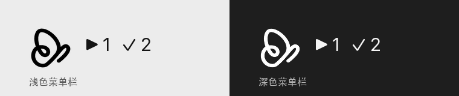

# Paseo Tray

An unofficial macOS menu bar tray for [Paseo](https://paseo.sh), plus a thin Paseo plugin.

Paseo 的 macOS 菜单栏托盘，外加一个薄 Paseo 插件。托盘是独立的 Swift App，Paseo 升级、插件禁用或重载都不会影响它。



菜单栏图标使用 Paseo 官方 icon 的 logo mark 生成 template（16/32px，自动适配浅色/深色菜单栏）；app 与通知图标使用官方 `PaseoIcon.icns`。


## 它做什么

- 菜单栏显示 `▶ running`、`✓ finished`、`! needs_input + failed`。
- 点击菜单直接跳到 Paseo 对应 agent。
- 新完成/失败/权限事件会让菜单栏图标闪烁（不依赖系统通知开关）。
- 可选系统通知、登录自启。
- Paseo 侧边栏镜像同样的计数，并提供 agent 列表和设置页。
- 插件会检测托盘 App 是否安装；未安装时在 agents screen 和设置页显示下载提醒。

托盘直连 Paseo daemon 的 WebSocket，不依赖插件运行。插件只负责应用内镜像和设置。

## 下载安装

### GitHub Releases

正式版发布后：

1. 打开 [Releases](https://github.com/romejiang/paseo-tray/releases/latest)。
2. 下载 `PaseoTray-<version>.dmg`。
3. 把 `PaseoTray.app` 拖进 `/Applications`。
4. 首次启动后，菜单栏会出现 Paseo logo。

> 首个正式版正在准备 Developer ID 签名与公证。发布前请使用下面的源码构建；源码构建是 ad-hoc 签名，只适合本机使用。

### Homebrew

首个签名 Release 发布后：

```bash
brew install --cask romejiang/tap/paseo-tray
```

升级：

```bash
brew upgrade --cask paseo-tray
```

卸载：

```bash
brew uninstall --cask paseo-tray
```

### 从源码构建

要求 macOS 13+、Xcode Command Line Tools。

```bash
git clone https://github.com/romejiang/paseo-tray.git
cd paseo-tray
./tray/build.sh
./tray/install.sh
```

- `build.sh` 生成 `tray/build/PaseoTray.app`（当前架构，ad-hoc 签名）。
- `install.sh` 拷贝到 `~/Applications/PaseoTray.app` 并启动。
- 不会覆盖 `/Applications/Paseo.app`。

离线看 UI：

```bash
open ~/Applications/PaseoTray.app --args --demo
```

Demo 使用固定假数据（2 running / 1 finished / 1 needs_input），不连接 daemon。

## 安装 Paseo 插件

```bash
PASEO=/Applications/Paseo.app/Contents/Resources/bin/paseo
$PASEO plugin install "$PWD/plugin" --id paseo-tray
$PASEO plugin reload paseo-tray
$PASEO plugin logs paseo-tray
```

安装后：

- Paseo 侧边栏 footer 出现 `Paseo Tray  ▶2 ✓0`，点击打开 agent 列表。
- Settings → Plugins → `paseo-tray` 的 `...` → Tray 打开设置页。
- Command Center 里有 `Open Paseo Tray agents` 和 `Configure Paseo Tray`。
- 如果托盘 App 未安装，agents screen 顶部和设置页会显示下载提醒。

插件只写配置文件，不负责创建/启动托盘 App。

## 菜单栏含义

| 标题 | 含义 |
| --- | --- |
| `▶ n` | running 数量 |
| `✓ n` | finished / attention 数量（用户还没看） |
| `! n` | needs_input + failed 数量，红色 |
| `–` | 离线、需要密码或不支持的连接方式，图标变灰 |
| 只有图标 | 没有 running / finished / 需要处理的 agent |

菜单分区顺序：需要你处理 → 失败 → 运行中 → 已完成。点击条目打开：

```
paseo://h/<serverId>/agent/<agentId>
```

- 待处理按 `attentionTimestamp` 升序（最老的最上面）。
- 运行中按 `activeTurn.startedAt` 升序。
- 已完成按 `attentionTimestamp` 降序（最新的最上面）。

普通 `idle`（`done` 桶）不显示、不计数；完成信号统一来自 `agent_attention_required`，不用 `status === "idle"` 推断。

## 配置

共享文件：

```
~/Library/Application Support/PaseoTray/config.json
```

| 字段 | 默认 | 作用 |
| --- | --- | --- |
| `showRunningCount` | `true` | 菜单栏是否显示 `▶ n` |
| `showFinishedCount` | `true` | 菜单栏是否显示 `✓ n` |
| `notifyOnFinish` | `false` | 完成时系统通知 |
| `notifyOnError` | `false` | 出错时系统通知 |
| `notifyOnPermission` | `false` | 需要权限时系统通知 |
| `playSound` | `false` | 通知声音 |
| `includeSubagents` | `false` | 是否显示带 `paseo.parent-agent-id` 的子 agent |

三个 notify 开关默认都是 `false`，避免和 Paseo 自带通知重复；需要时在插件设置里逐项打开。

托盘监听**配置目录**（`DispatchSource.makeFileSystemObjectSource`），不是文件 inode。插件用临时文件 + `rename` 原子写，保存后通常 < 1 秒生效。插件被禁用时托盘继续使用最后一次配置。

托盘启动时只读配置，不会创建文件；文件不存在时使用内存默认值。只有用户点击“托盘设置…”时才按需创建，避免和插件的原子写竞争。

插件设置页会调用 `tray.config.status`，在挂载时和每次保存后显示最近一次写入结果：`已同步` 或 `写入失败：…`。该 RPC 会等待当前写入队列结束再返回，所以不会把旧的成功状态误报成新保存的结果。

## 通知

- 默认全部关闭，避免和 Paseo 自带通知重复。
- **即使系统通知关闭**，新的 `finished` / `error` / `permission` 事件在 Paseo 不在前台时会闪烁菜单栏图标并更新计数。去重键 `agentId + reason + timestamp`，10 分钟内只闪一次。
- 打开后，`NSWorkspace.shared.frontmostApplication?.bundleIdentifier == "sh.paseo.desktop"` 时跳过。
- 通知点击打开同一深链。
- 需要 macOS 通知权限；首次打开时系统会询问。
- 如果 `UNUserNotificationCenter` 不可用或发送失败，降级为 `NSSound.beep()` + 菜单栏图标闪烁。
- 可用 `--test-notification` 验证投递；`--notification-status` 查看授权；`--delivered-notifications` 查看已投递通知；`--clear-notifications` 清理测试通知。

## 登录自启

使用 `SMAppService.mainApp.register()` / `unregister()`（macOS 13+），不写 LaunchAgent plist。

- 菜单勾选状态读 `SMAppService.mainApp.status`。
- `.requiresApproval` 时菜单显示“需在系统设置中批准”，点击会打开系统设置的登录项页面。
- App 在 `~/Applications` 且未注册时，`status` 可能是 `.notFound`；菜单仍然允许点击注册。
- 注册/注销失败时菜单项置灰，tooltip 显示失败原因，同时弹出 alert。
- 测试/诊断：

```bash
~/Applications/PaseoTray.app/Contents/MacOS/PaseoTray --login-item-status
~/Applications/PaseoTray.app/Contents/MacOS/PaseoTray --login-item-register
~/Applications/PaseoTray.app/Contents/MacOS/PaseoTray --login-item-unregister
```

## 开发

### 结构

```
tray/                 Swift/AppKit 菜单栏 App
  Sources/            AppDelegate, PaseoClient, AgentStore, MenuController...
  Resources/          官方 icon 生成的 template + PaseoIcon.icns
  build.sh            当前架构构建
  build-universal.sh  arm64 + x86_64 通用构建
plugin/               Paseo 插件
  client/             sidebar、agents screen、settings screen
  server/             配置原子写、托盘安装检测
  shared/             设置 schema、纯逻辑、RPC 契约
test/                 mock daemon + acceptance + 真实插件探针
scripts/              release DMG、cask 更新
packaging/            GitHub Actions、Homebrew cask 模板
```

### 环境

- macOS 13+，Xcode Command Line Tools。
- Paseo 0.14.0+。
- Node 22+（插件开发/typecheck；运行时由 Paseo 提供）。

### 测试

```bash
# 纯逻辑
~/Applications/PaseoTray.app/Contents/MacOS/PaseoTray --self-check

# 连一次 daemon
~/Applications/PaseoTray.app/Contents/MacOS/PaseoTray --selftest

# 持续输出 JSON：status / snapshot / update / attention / announce / config
~/Applications/PaseoTray.app/Contents/MacOS/PaseoTray --watch-json

# mock daemon 可控验收
cd test && npm install && cd ..
node test/acceptance.mjs

# 真实 daemon：插件设置写入 + tray.config.status + tray.app.status
node test/plugin-settings-probe.mjs

# 插件类型检查
cd plugin && npm run typecheck
```

### 发布

首次申请 Developer ID Application 证书：

```bash
# 生成 CSR；私钥留在本机，不提交
./scripts/create-developer-id-csr.sh

# Account Holder 在 developer.apple.com 上传 CSR 并下载 .cer 后
./scripts/install-developer-id.sh ~/Downloads/DeveloperIDApplication.cer
```

通用二进制 + ad-hoc（本机测试）：

```bash
./scripts/package-release.sh 0.1.0
```

Developer ID 签名 + 公证（正式发布）：

```bash
PASEOTRAY_SIGN_IDENTITY="Developer ID Application: ..." \
PASEOTRAY_SIGN_KEYCHAIN="$HOME/.paseo-tray-signing/PaseoTray.keychain-db" \
PASEOTRAY_NOTARY_PROFILE="PaseoTrayNotary" \
./scripts/package-release.sh 0.1.0
```

产物：

```
dist/PaseoTray-0.1.0.dmg
dist/PaseoTray-0.1.0.dmg.sha256
```

发布 Homebrew cask（GitHub Release 已发布后）：

```bash
scripts/publish-homebrew.sh 0.1.0
```

GitHub Actions 模板在 `packaging/github/release.yml`，Homebrew cask 模板在 `packaging/homebrew/Casks/paseo-tray.rb`。两者的配置步骤见对应 README。

### 版本兼容

参考源码是 Paseo 0.15.0，但本项目按运行中的 0.14 daemon 实现：

- 使用 0.14 已有的 `addSidebarFooterItem`、`addScreen`、`addSettingsScreen`、`useSettings`、`navigation.openAgent`。
- 不使用 0.15 才有的 `server.addHook("agent.turn.after", ...)`。
- `requirements.paseo` 为 `>=0.14.0`，devDependency 固定 `@getpaseo/plugin@0.14.0`。

## 卸载

```bash
PASEO=/Applications/Paseo.app/Contents/Resources/bin/paseo
$PASEO plugin disable paseo-tray
$PASEO plugin remove paseo-tray

killall PaseoTray 2>/dev/null || true
rm -rf ~/Applications/PaseoTray.app
rm -rf ~/Library/Application\ Support/PaseoTray
```

`plugin remove` 会删除插件配置；托盘配置目录需要手动删除。

## 已知限制

- 只支持 `paseo.pid` / `config.json` 中 `host:port` 形式的 daemon listen；Unix socket、pipe 显示“不支持”。
- 只支持本机 daemon；多 host、relay、远程托盘不在 v1 范围。
- 托盘只读 `~/.paseo/local-credential`，不会弹密码框；daemon 要求密码而 credential 失效时显示“需要密码”，提供“打开 Paseo”入口。
- 菜单栏 item 跟随当前活跃显示器；多显示器或 Hidden Bar 之类的菜单栏管理器可能把它放进隐藏区，这是系统行为。
- ad-hoc 签名下 `SMAppService` 可能需要系统设置批准；通知在 Focus/勿扰模式下可能不显示横幅，但 `--delivered-notifications` 可确认已投递。
- 插件是 host 级设置，只对同机 daemon 有意义。

## 安全

- 托盘只读 `~/.paseo/local-credential`，token 只放在 `hello.auth`，不写日志、不写配置、不拼 URL。
- 插件是 Paseo 的受信任代码，server 端在 daemon 主机上无沙箱运行；只写一个非敏感 JSON 配置文件。
- 不改 `/Applications/Paseo.app`，不改 `~/.paseo/config.json` 的 `pluginsEnabled`，不碰用户已有插件。

## License / Trademark

代码使用 MIT License，见 [LICENSE](LICENSE)。

Paseo Tray 是非官方 companion 项目。Paseo 名称与 Paseo logo 归其所有者所有；菜单栏 template 由 Paseo app icon 派生，仅用于视觉一致性。见 [NOTICE.md](NOTICE.md)。
