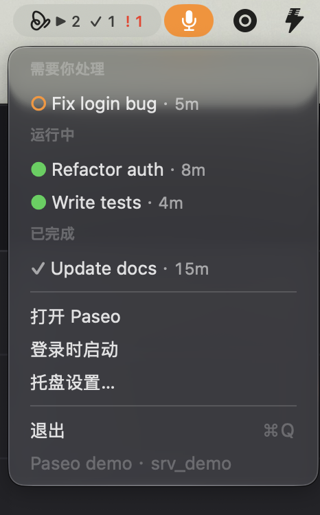
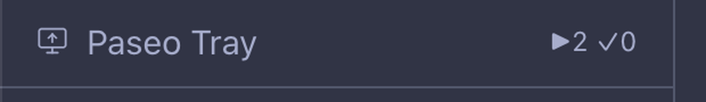
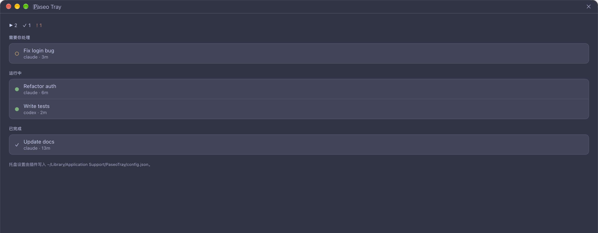
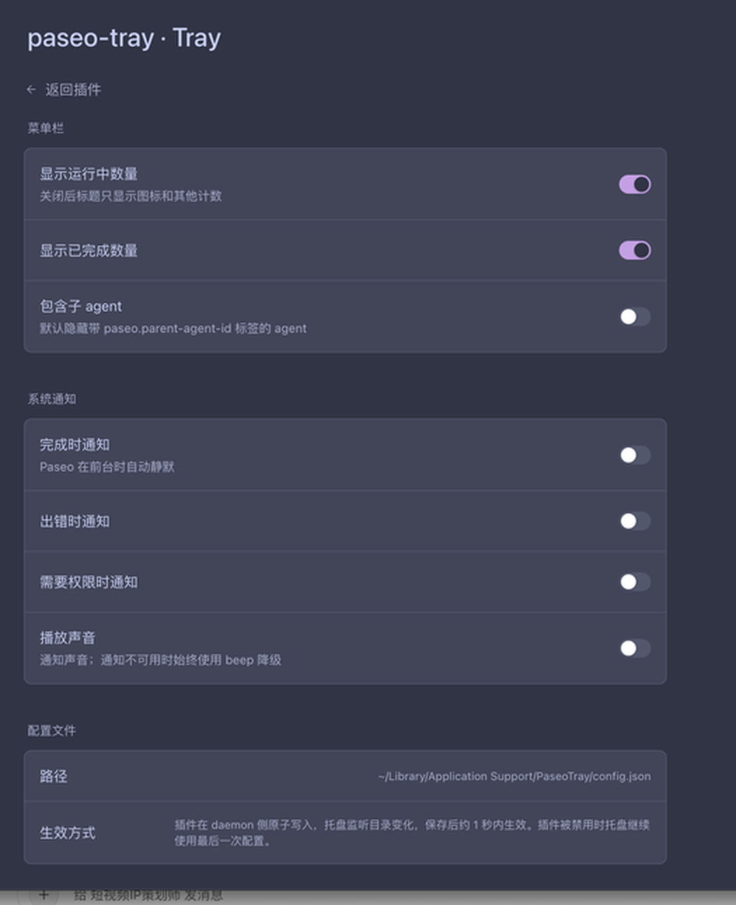

# Paseo Tray

[中文](#中文) · [English](#english)

---

## 中文

Paseo Tray 是 [Paseo](https://paseo.sh) 的非官方 macOS 菜单栏托盘，外加一个薄
Paseo 插件。托盘是独立的 Swift App，Paseo 升级、插件禁用或重载都不会影响它。

当 Paseo 在后台跑多个 agent 时，你不需要来回切窗口确认谁在运行、谁完成了、谁在等
你授权：菜单栏直接显示计数，点一下就能跳到对应的 agent。

### 截图

菜单栏图标（浅色 / 深色菜单栏）：


点击图标打开托盘菜单，按「需要你处理 → 失败 → 运行中 → 已完成」分组：



插件在 Paseo 侧边栏镜像同样的计数，并提供完整的 agent 列表页：





所有托盘设置都能在插件设置页里改：



### 它做什么

- 菜单栏显示 `▶ running`、`✓ finished`、`! needs_input + failed`。
- 点击菜单直接跳到 Paseo 对应 agent。
- 新完成/失败/权限事件会让菜单栏图标闪烁（不依赖系统通知开关）。
- 可选系统通知、登录自启。
- Paseo 侧边栏镜像同样的计数，并提供 agent 列表和设置页。
- 插件会检测托盘 App 是否安装；未安装时在 agents screen 和设置页显示下载提醒。

托盘直连 Paseo daemon 的 WebSocket，不依赖插件运行。插件只负责应用内镜像和设置。

### 下载安装

#### GitHub Releases

1. 打开 [Releases](https://github.com/romejiang/paseo-tray/releases/latest)。
2. 下载 `PaseoTray-<version>.dmg`。
3. 把 `PaseoTray.app` 拖进 `/Applications`。
4. 首次启动后，菜单栏会出现 Paseo logo。

#### Homebrew

```bash
brew tap romejiang/tap
brew trust romejiang/tap
brew install --cask romejiang/tap/paseo-tray
```

升级：

```bash
brew upgrade --cask paseo-tray
```

卸载：

```bash
brew uninstall --cask paseo-tray
```

#### 从源码构建

要求 macOS 13+、Xcode Command Line Tools。

```bash
git clone https://github.com/romejiang/paseo-tray.git
cd paseo-tray
./tray/build.sh
./tray/install.sh
```

- `build.sh` 生成 `tray/build/PaseoTray.app`（当前架构，ad-hoc 签名）。
- `install.sh` 拷贝到 `~/Applications/PaseoTray.app` 并启动。
- 不会覆盖 `/Applications/Paseo.app`。

离线看 UI：

```bash
open ~/Applications/PaseoTray.app --args --demo
```

Demo 使用固定假数据（2 running / 1 finished / 1 needs_input），不连接 daemon。

### 安装 Paseo 插件

从插件市场安装：

```bash
paseo plugin add romejiang/paseo-tray
```

本地开发安装：

```bash
PASEO=/Applications/Paseo.app/Contents/Resources/bin/paseo
$PASEO plugin install "$PWD/plugin" --id paseo-tray
$PASEO plugin reload paseo-tray
$PASEO plugin logs paseo-tray
```

安装后：

- Paseo 侧边栏 footer 出现 `Paseo Tray  ▶2 ✓0`，点击打开 agent 列表。
- Settings → Plugins → `paseo-tray` 的 `...` → Tray 打开设置页。
- Command Center 里有 `Open Paseo Tray agents` 和 `Configure Paseo Tray`。
- 如果托盘 App 未安装，agents screen 顶部和设置页会显示下载提醒。

插件只写配置文件，不负责创建/启动托盘 App。

### 菜单栏含义

| 标题 | 含义 |
| --- | --- |
| `▶ n` | running 数量 |
| `✓ n` | finished / attention 数量（用户还没看） |
| `! n` | needs_input + failed 数量，红色 |
| `–` | 离线、需要密码或不支持的连接方式，图标变灰 |
| 只有图标 | 没有 running / finished / 需要处理的 agent |

该表描述默认配置（两个计数开关都打开）。关闭 `显示运行中数量` 或
`显示已完成数量` 后，即使有 running / finished agent，标题也可能只剩图标；
`–` 也包括正在连接的状态。

菜单分区顺序：需要你处理 → 失败 → 运行中 → 已完成。点击条目打开：

```
paseo://h/<serverId>/agent/<agentId>
```

- 待处理按 `attentionTimestamp` 升序（最老的最上面）。
- 运行中按 `activeTurn.startedAt` 升序。
- 已完成按 `attentionTimestamp` 降序（最新的最上面）。

普通 `idle`（`done` 桶）不显示、不计数；完成信号统一来自
`agent_attention_required`，不用 `status === "idle"` 推断。

### 配置

共享文件：

```
~/Library/Application Support/PaseoTray/config.json
```

| 字段 | 默认 | 作用 |
| --- | --- | --- |
| `showRunningCount` | `true` | 菜单栏是否显示 `▶ n` |
| `showFinishedCount` | `true` | 菜单栏是否显示 `✓ n` |
| `notifyOnFinish` | `false` | 完成时系统通知 |
| `notifyOnError` | `false` | 出错时系统通知 |
| `notifyOnPermission` | `false` | 需要权限时系统通知 |
| `playSound` | `false` | 通知声音 |
| `includeSubagents` | `false` | 是否显示带 `paseo.parent-agent-id` 的子 agent |

三个 notify 开关默认都是 `false`，避免和 Paseo 自带通知重复；需要时在插件设置里逐
项打开。

托盘监听**配置目录**（`DispatchSource.makeFileSystemObjectSource`），不是文件
inode。插件用临时文件 + `rename` 原子写，保存后通常 < 1 秒生效。插件被禁用时托
盘继续使用最后一次配置。

托盘启动时只读配置，不会创建文件；文件不存在时使用内存默认值。只有用户点击“托盘
设置…”时才按需创建，避免和插件的原子写竞争。

插件设置页会调用 `tray.config.status`，在挂载时和每次保存后显示最近一次写入结果：
`已同步` 或 `写入失败：…`。该 RPC 会等待当前写入队列结束再返回，所以不会把旧的
成功状态误报成新保存的结果。

### 通知

- 默认全部关闭，避免和 Paseo 自带通知重复。
- **即使系统通知关闭**，新的 `finished` / `error` / `permission` 事件在 Paseo 不
  在前台时会闪烁菜单栏图标并更新计数。同一 `agentId + reason + timestamp`
  事件 10 分钟内只闪一次；不同事件仍会再次闪烁。
- 打开后，`NSWorkspace.shared.frontmostApplication?.bundleIdentifier ==
  "sh.paseo.desktop"` 时跳过。
- 通知点击打开同一深链。
- 需要 macOS 通知权限；首次打开时系统会询问。
- 如果 `UNUserNotificationCenter` 不可用或发送失败，降级为 `NSSound.beep()` +
  菜单栏图标闪烁。
- 可用 `--test-notification` 验证投递；`--notification-status` 查看授权；
  `--delivered-notifications` 查看已投递通知；`--clear-notifications` 清空所有
  已投递通知。

### 登录自启

使用 `SMAppService.mainApp.register()` / `unregister()`（macOS 13+），不写
LaunchAgent plist。

- 菜单勾选状态读 `SMAppService.mainApp.status`。
- `.requiresApproval` 时菜单显示“需在系统设置中批准”，点击会打开系统设置的登录项
  页面。
- App 在 `~/Applications` 且未注册时，`status` 可能是 `.notFound`；菜单仍然允许
  点击注册。
- 注册/注销失败时菜单项置灰，tooltip 显示失败原因，同时弹出 alert。
- 测试/诊断：

```bash
~/Applications/PaseoTray.app/Contents/MacOS/PaseoTray --login-item-status
~/Applications/PaseoTray.app/Contents/MacOS/PaseoTray --login-item-register
~/Applications/PaseoTray.app/Contents/MacOS/PaseoTray --login-item-unregister
```

### 开发

#### 结构

```
tray/                 Swift/AppKit 菜单栏 App
  Sources/            AppDelegate, PaseoClient, AgentStore, MenuController...
  Resources/          官方 icon 生成的 template + PaseoIcon.icns
  build.sh            当前架构构建
  build-universal.sh  arm64 + x86_64 通用构建
plugin/               Paseo 插件
  client/             sidebar、agents screen、settings screen
  server/             配置原子写、托盘安装检测
  shared/             设置 schema、纯逻辑、RPC 契约
  assets/             插件市场 icon 和截图
test/                 mock daemon + acceptance + 真实插件探针
scripts/              release DMG、cask 更新
packaging/            GitHub Actions、Homebrew cask 模板
```

#### 环境

- macOS 13+，Xcode Command Line Tools。
- Paseo 0.14.0+。
- Node 22+（插件开发/typecheck；运行时由 Paseo 提供）。

#### 测试

```bash
# 纯逻辑
~/Applications/PaseoTray.app/Contents/MacOS/PaseoTray --self-check

# 连一次 daemon
~/Applications/PaseoTray.app/Contents/MacOS/PaseoTray --selftest

# 持续输出 JSON：status / snapshot / update / attention / announce / config
~/Applications/PaseoTray.app/Contents/MacOS/PaseoTray --watch-json

# mock daemon 可控验收（脚本使用 tray/build/PaseoTray.app，先跑 ./tray/build.sh）
cd test && npm install && cd ..
node test/acceptance.mjs

# 真实 daemon：插件设置写入 + tray.config.status + tray.app.status
node test/plugin-settings-probe.mjs

# 插件类型检查
cd plugin && npm run typecheck
```

#### 发布

首次申请 Developer ID Application 证书：

```bash
# 生成 CSR；私钥留在本机，不提交
./scripts/create-developer-id-csr.sh

# Account Holder 在 developer.apple.com 上传 CSR 并下载 .cer 后
./scripts/install-developer-id.sh ~/Downloads/DeveloperIDApplication.cer
```

如果团队已经开通 App Store Connect API，并且 Account Holder 创建了 **Admin** 角色
的 API key，也可以全自动申请（注意：不是 APNs 的 `AuthKey_*.p8`）：

```bash
ASC_ISSUER_ID="..." \
ASC_KEY_ID="..." \
ASC_PRIVATE_KEY_PATH="$HOME/Downloads/AuthKey_XXXX.p8" \
node scripts/create-developer-id-via-api.mjs
```

通用二进制 + ad-hoc（本机测试）：

```bash
./scripts/package-release.sh 0.1.0
```

先把公证凭据存进钥匙串 profile（只需一次）：

```bash
xcrun notarytool store-credentials "PaseoTrayNotary" \
  --apple-id "you@example.com" \
  --team-id "TEAMID" \
  --password "app-specific-password"
```

Developer ID 签名 + 公证（正式发布）：

```bash
PASEOTRAY_SIGN_IDENTITY="Developer ID Application: ..." \
PASEOTRAY_SIGN_KEYCHAIN="$HOME/.paseo-tray-signing/PaseoTray.keychain-db" \
PASEOTRAY_NOTARY_PROFILE="PaseoTrayNotary" \
./scripts/package-release.sh 0.1.0
```

产物：

```
dist/PaseoTray-0.1.0.dmg
dist/PaseoTray-0.1.0.dmg.sha256
```

发布 Homebrew cask（GitHub Release 已发布后）：

```bash
scripts/publish-homebrew.sh 0.1.0
```

GitHub Actions 模板在 `packaging/github/release.yml`，Homebrew cask 模板在
`packaging/homebrew/Casks/paseo-tray.rb`。两者的配置步骤见对应 README。

#### 插件市场发布

插件市场读取 `plugin/paseo-plugin.json` 的 `icon`、`media`、`translations`，
以及 `plugin/OVERVIEW.md`（英文）和 `plugin/OVERVIEW.zh-CN.md`（中文）。
Git 源的更新需要带上新的 commit 重新提交市场审核。

#### 版本兼容

参考源码是 Paseo 0.15.0，但本项目按运行中的 0.14 daemon 实现：

- 使用 0.14 已有的 `addSidebarFooterItem`、`addScreen`、`addSettingsScreen`、
  `useSettings`、`navigation.openAgent`。
- 不使用 0.15 才有的 `server.addHook("agent.turn.after", ...)`。
- `requirements.paseo` 为 `>=0.14.0`，devDependency 固定 `@getpaseo/plugin@0.14.0`。

### 卸载

先移除插件：

```bash
PASEO=/Applications/Paseo.app/Contents/Resources/bin/paseo
$PASEO plugin disable paseo-tray
$PASEO plugin remove paseo-tray
```

再按安装方式移除托盘 App：

```bash
killall PaseoTray 2>/dev/null || true

# DMG 安装
rm -rf /Applications/PaseoTray.app

# 源码构建（install.sh）
rm -rf ~/Applications/PaseoTray.app

# Homebrew 安装
brew uninstall --cask paseo-tray
# 需要同时清理配置时
brew uninstall --zap --cask paseo-tray

# 清理共享配置（可选）
rm -rf ~/Library/Application\ Support/PaseoTray
```

`plugin remove` 会删除插件配置；托盘配置目录需要手动删除。

### 已知限制

- 只支持 `paseo.pid` / `config.json` 中 `host:port` 形式的 daemon listen；
  Unix socket、pipe 显示“不支持”。
- 只支持本机 daemon；多 host、relay、远程托盘不在 v1 范围。
- 托盘只读 `~/.paseo/local-credential`，不会弹密码框；daemon 要求密码而
  credential 失效时显示“需要密码”，提供“打开 Paseo”入口。
- 菜单栏 item 跟随当前活跃显示器；多显示器或 Hidden Bar 之类的菜单栏管理器可能把
  它放进隐藏区，这是系统行为。
- ad-hoc 签名下 `SMAppService` 可能需要系统设置批准；通知在 Focus/勿扰模式下可能
  不显示横幅，但 `--delivered-notifications` 可确认已投递。
- 插件是 host 级设置，只对同机 daemon 有意义。

### 安全

- 托盘只读 `~/.paseo/local-credential`，token 只放在 `hello.auth`，不写日志、不写
  配置、不拼 URL。
- 插件是 Paseo 的受信任代码，server 端在 daemon 主机上无沙箱运行；只写一个非敏感
  JSON 配置文件。
- 不改 `/Applications/Paseo.app`，不改 `~/.paseo/config.json` 的
  `pluginsEnabled`，不碰用户已有插件。

### License / Trademark

代码使用 MIT License，见 [LICENSE](LICENSE)。

Paseo Tray 是非官方 companion 项目。Paseo 名称与 Paseo logo 归其所有者所有；菜单
栏 template 由 Paseo app icon 派生，仅用于视觉一致性。见
[NOTICE.md](NOTICE.md)。

---

## English

Paseo Tray is an unofficial macOS menu bar tray for [Paseo](https://paseo.sh),
plus a thin Paseo plugin. The tray is a separate Swift app, so Paseo upgrades,
plugin reloads, or a disabled plugin never affect it.

When Paseo runs several agents in the background, you should not have to switch
windows to see what is running, what finished, and what is waiting for your
approval. The menu bar shows the counts, and one click takes you to the agent.

The menu bar app and plugin screens currently use Simplified Chinese UI labels.
This section translates them; the original labels appear in parentheses where
they matter.

### Screenshots

Menu bar icon (light / dark menu bar):


Click the icon to open the tray menu, grouped as needs you → failed → running →
finished:


The plugin mirrors the same counts in Paseo's sidebar and adds a full agent
screen:


Every tray setting is available in the plugin's settings screen:


### What it does

- The menu bar shows `▶ running`, `✓ finished`, `! needs_input + failed`.
- Clicking a menu row opens the matching Paseo agent.
- New finished, failed, and permission events flash the menu bar icon, even
  with system notifications off.
- Optional system notifications and launch at login.
- The Paseo sidebar mirrors the same counts and links to the agent list and
  settings screen.
- The plugin detects whether the tray app is installed and shows a download
  reminder in the agent screen and settings when it is missing.

The tray connects directly to the Paseo daemon over its WebSocket API and does
not depend on the plugin. The plugin only provides the in-app mirror and
settings.

### Install

#### GitHub Releases

1. Open [Releases](https://github.com/romejiang/paseo-tray/releases/latest).
2. Download `PaseoTray-<version>.dmg`.
3. Drag `PaseoTray.app` into `/Applications`.
4. After the first launch, the Paseo logo appears in the menu bar.

#### Homebrew

```bash
brew tap romejiang/tap
brew trust romejiang/tap
brew install --cask romejiang/tap/paseo-tray
```

Upgrade:

```bash
brew upgrade --cask paseo-tray
```

Uninstall:

```bash
brew uninstall --cask paseo-tray
```

#### Build from source

Requires macOS 13+ and Xcode Command Line Tools.

```bash
git clone https://github.com/romejiang/paseo-tray.git
cd paseo-tray
./tray/build.sh
./tray/install.sh
```

- `build.sh` produces `tray/build/PaseoTray.app` for the current architecture
  with an ad-hoc signature.
- `install.sh` copies it to `~/Applications/PaseoTray.app` and launches it.
- It never overwrites `/Applications/Paseo.app`.

Preview the UI offline:

```bash
open ~/Applications/PaseoTray.app --args --demo
```

The demo uses fixed fake data (2 running / 1 finished / 1 needs_input) and does
not connect to the daemon.

### Install the Paseo plugin

From the plugin marketplace:

```bash
paseo plugin add romejiang/paseo-tray
```

For local development:

```bash
PASEO=/Applications/Paseo.app/Contents/Resources/bin/paseo
$PASEO plugin install "$PWD/plugin" --id paseo-tray
$PASEO plugin reload paseo-tray
$PASEO plugin logs paseo-tray
```

After installing:

- Paseo's sidebar footer shows `Paseo Tray  ▶2 ✓0`; click it to open the agent
  list.
- Settings → Plugins → `paseo-tray` → `...` → Tray opens the settings screen.
- Command Center contains `Open Paseo Tray agents` and `Configure Paseo Tray`.
- If the tray app is not installed, the agent screen and settings show a
  download reminder.

The plugin only writes the config file; it does not create or start the tray
app.

### Menu bar meanings

| Title | Meaning |
| --- | --- |
| `▶ n` | Number of running agents |
| `✓ n` | Finished / attention agents you have not looked at yet |
| `! n` | needs_input + failed agents, in red |
| `–` | Offline, password required, or unsupported connection; icon dimmed |
| Icon only | No running, finished, or needs-input agents |

The table describes the default configuration (both count switches on). If you
turn off `Show running count` or `Show finished count`, the title can show only
the icon even while agents are running or finished. `–` also covers the
connecting state.

Menu sections are ordered: needs you → failed → running → finished. Clicking a
row opens:

```
paseo://h/<serverId>/agent/<agentId>
```

- Needs-input rows sort by `attentionTimestamp` ascending (oldest first).
- Running rows sort by `activeTurn.startedAt` ascending.
- Finished rows sort by `attentionTimestamp` descending (newest first).

Plain `idle` agents (the `done` bucket) are not shown or counted. The finished
signal comes from `agent_attention_required`, not from `status === "idle"`.

### Configuration

Shared file:

```
~/Library/Application Support/PaseoTray/config.json
```

| Field | Default | Effect |
| --- | --- | --- |
| `showRunningCount` | `true` | Show `▶ n` in the menu bar |
| `showFinishedCount` | `true` | Show `✓ n` in the menu bar |
| `notifyOnFinish` | `false` | System notification when an agent finishes |
| `notifyOnError` | `false` | System notification on error |
| `notifyOnPermission` | `false` | System notification when permission is needed |
| `playSound` | `false` | Notification sound |
| `includeSubagents` | `false` | Show agents labeled `paseo.parent-agent-id` |

All three notify switches default to `false` to avoid duplicating Paseo's own
notifications; enable them individually in the plugin settings.

The tray watches the **config directory**
(`DispatchSource.makeFileSystemObjectSource`), not the file inode. The plugin
writes with a temporary file plus `rename`, so a save usually applies in under
a second. If the plugin is disabled, the tray keeps using the last config.

The tray only reads the config at launch and never creates the file; it uses
in-memory defaults when the file is missing. It creates the file on demand only
when the user picks 「托盘设置…」 (Tray settings…), avoiding races with the
plugin's atomic writes.

The plugin settings screen calls `tray.config.status` on mount and after every
save to show the last write result: 「已同步」 (Synced) or 「写入失败：…」 (Write
failed: …). That RPC waits for the current write queue to drain before
returning, so it never reports an old success as a new save.

### Notifications

- All off by default, to avoid duplicating Paseo's own notifications.
- **Even with system notifications off**, a new `finished` / `error` /
  `permission` event flashes the menu bar icon and updates the counts when Paseo
  is not frontmost. The dedupe key is `agentId + reason + timestamp`: an
  identical event flashes at most once per 10 minutes; a different event flashes
  again.
- When enabled, the tray skips notifications while
  `NSWorkspace.shared.frontmostApplication?.bundleIdentifier ==
  "sh.paseo.desktop"`.
- Clicking a notification opens the same deep link.
- macOS notification permission is required; the system asks the first time you
  enable one.
- If `UNUserNotificationCenter` is unavailable or delivery fails, the tray falls
  back to `NSSound.beep()` plus a menu bar icon flash.
- Diagnostics: `--test-notification` verifies delivery;
  `--notification-status` shows authorization; `--delivered-notifications`
  lists delivered notifications; `--clear-notifications` removes all delivered
  notifications.

### Launch at login

Uses `SMAppService.mainApp.register()` / `unregister()` (macOS 13+) and does
not write a LaunchAgent plist.

- The menu checkmark reads `SMAppService.mainApp.status`.
- On `.requiresApproval`, the menu shows 「登录时启动（需在系统设置中批准）」
  (Approve in System Settings); clicking opens the login items page.
- When the app lives in `~/Applications` and is not registered, `status` may be
  `.notFound`; the menu still allows registering.
- If registration or unregistration fails, the menu item is disabled, the
  tooltip shows the reason, and an alert appears.
- Diagnostics:

```bash
~/Applications/PaseoTray.app/Contents/MacOS/PaseoTray --login-item-status
~/Applications/PaseoTray.app/Contents/MacOS/PaseoTray --login-item-register
~/Applications/PaseoTray.app/Contents/MacOS/PaseoTray --login-item-unregister
```

### Development

#### Layout

```
tray/                 Swift/AppKit menu bar app
  Sources/            AppDelegate, PaseoClient, AgentStore, MenuController...
  Resources/          Template generated from the official icon + PaseoIcon.icns
  build.sh            Current-architecture build
  build-universal.sh  arm64 + x86_64 universal build
plugin/               Paseo plugin
  client/             Sidebar, agents screen, settings screen
  server/             Atomic config writes, tray install detection
  shared/             Settings schema, pure logic, RPC contracts
  assets/             Marketplace icon and screenshots
test/                 Mock daemon + acceptance + real-plugin probes
scripts/              Release DMG, cask updates
packaging/            GitHub Actions, Homebrew cask templates
```

#### Requirements

- macOS 13+, Xcode Command Line Tools.
- Paseo 0.14.0+.
- Node 22+ for plugin development and typechecking; Paseo provides the runtime.

#### Tests

```bash
# Pure logic
~/Applications/PaseoTray.app/Contents/MacOS/PaseoTray --self-check

# Connect to the daemon once
~/Applications/PaseoTray.app/Contents/MacOS/PaseoTray --selftest

# Stream JSON: status / snapshot / update / attention / announce / config
~/Applications/PaseoTray.app/Contents/MacOS/PaseoTray --watch-json

# Controlled acceptance against the mock daemon
# (uses tray/build/PaseoTray.app, so run ./tray/build.sh first)
cd test && npm install && cd ..
node test/acceptance.mjs

# Real daemon: plugin settings write + tray.config.status + tray.app.status
node test/plugin-settings-probe.mjs

# Plugin typecheck
cd plugin && npm run typecheck
```

#### Release

Create a Developer ID Application certificate the first time:

```bash
# Generate a CSR; keep the private key local and never commit it
./scripts/create-developer-id-csr.sh

# After the Account Holder uploads the CSR and downloads the .cer
./scripts/install-developer-id.sh ~/Downloads/DeveloperIDApplication.cer
```

If the team has App Store Connect API access and the Account Holder created an
**Admin** API key, the certificate can also be requested automatically (note:
this is not the APNs `AuthKey_*.p8`):

```bash
ASC_ISSUER_ID="..." \
ASC_KEY_ID="..." \
ASC_PRIVATE_KEY_PATH="$HOME/Downloads/AuthKey_XXXX.p8" \
node scripts/create-developer-id-via-api.mjs
```

Universal binary + ad-hoc (local testing):

```bash
./scripts/package-release.sh 0.1.0
```

Store the notarization credentials in a keychain profile first (once):

```bash
xcrun notarytool store-credentials "PaseoTrayNotary" \
  --apple-id "you@example.com" \
  --team-id "TEAMID" \
  --password "app-specific-password"
```

Developer ID signing + notarization (official release):

```bash
PASEOTRAY_SIGN_IDENTITY="Developer ID Application: ..." \
PASEOTRAY_SIGN_KEYCHAIN="$HOME/.paseo-tray-signing/PaseoTray.keychain-db" \
PASEOTRAY_NOTARY_PROFILE="PaseoTrayNotary" \
./scripts/package-release.sh 0.1.0
```

Artifacts:

```
dist/PaseoTray-0.1.0.dmg
dist/PaseoTray-0.1.0.dmg.sha256
```

Publish the Homebrew cask (after the GitHub Release is live):

```bash
scripts/publish-homebrew.sh 0.1.0
```

The GitHub Actions template lives at `packaging/github/release.yml`, and the
Homebrew cask template at `packaging/homebrew/Casks/paseo-tray.rb`. See their
READMEs for the configuration steps.

#### Marketplace listing

The marketplace reads `icon`, `media`, and `translations` from
`plugin/paseo-plugin.json`, plus `plugin/OVERVIEW.md` (English) and
`plugin/OVERVIEW.zh-CN.md` (Chinese). Git-sourced updates need a new submission
with the new commit.

#### Version compatibility

The reference source is Paseo 0.15.0, but this project targets the running 0.14
daemon:

- Uses `addSidebarFooterItem`, `addScreen`, `addSettingsScreen`,
  `useSettings`, and `navigation.openAgent`, all available in 0.14.
- Does not use `server.addHook("agent.turn.after", ...)`, which only exists in
  0.15.
- `requirements.paseo` is `>=0.14.0`, and the devDependency pins
  `@getpaseo/plugin@0.14.0`.

### Uninstall

Remove the plugin first:

```bash
PASEO=/Applications/Paseo.app/Contents/Resources/bin/paseo
$PASEO plugin disable paseo-tray
$PASEO plugin remove paseo-tray
```

Then remove the tray app according to how you installed it:

```bash
killall PaseoTray 2>/dev/null || true

# DMG install
rm -rf /Applications/PaseoTray.app

# Source build (install.sh)
rm -rf ~/Applications/PaseoTray.app

# Homebrew install
brew uninstall --cask paseo-tray
# Remove the config as well
brew uninstall --zap --cask paseo-tray

# Remove the shared config (optional)
rm -rf ~/Library/Application\ Support/PaseoTray
```

`plugin remove` deletes the plugin config; the tray config directory must be
removed manually.

### Known limits

- Only a daemon advertised as `host:port` in `paseo.pid` / `config.json` is
  supported; Unix socket and pipe endpoints report “unsupported”.
- Local daemons only; multiple hosts, relay, and remote trays are out of scope
  for v1.
- The tray only reads `~/.paseo/local-credential` and never prompts for a
  password. If the daemon requires one and the credential is invalid, it shows
  「需要密码」 (Password required) with an 「打开 Paseo」 (Open Paseo) action.
- The menu bar item follows the active display; multi-display setups or menu
  bar managers such as Hidden Bar may move it into a hidden section. That is
  system behavior.
- With an ad-hoc signature, `SMAppService` may require approval in System
  Settings. Notifications may not show banners in Focus mode, but
  `--delivered-notifications` confirms delivery.
- Plugin settings are host-level and only meaningful for a daemon on the same
  machine.

### Security

- The tray only reads `~/.paseo/local-credential`; the token goes into
  `hello.auth` only. It is never logged, written to config, or embedded in a
  URL.
- The plugin is trusted Paseo code and runs unsandboxed on the daemon host; it
  writes only one non-sensitive JSON config file.
- It does not modify `/Applications/Paseo.app`, does not touch
  `pluginsEnabled` in `~/.paseo/config.json`, and does not change any existing
  plugins.

### License / Trademark

The code is MIT licensed; see [LICENSE](LICENSE).

Paseo Tray is an unofficial companion project. The Paseo name and logo belong
to their owners; the menu bar template is derived from the Paseo app icon for
visual consistency only. See [NOTICE.md](NOTICE.md).
